# DeTh-Stereo Dataset

We collected and constructed the **Thermal-Stereo Dataset** across seven scenarios over 14 sequences, comprising 6,797 data sets with a total of 33,985 images. Each data set underwent rectification, denoising, and a combined semi-automated and manual filtering process to eliminate corrupted samples.

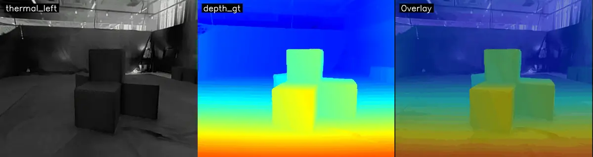

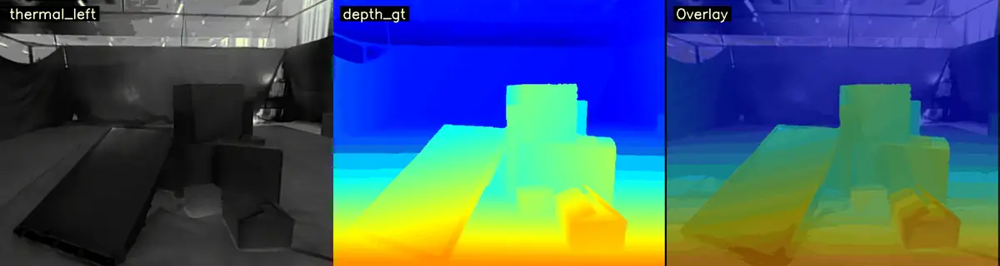

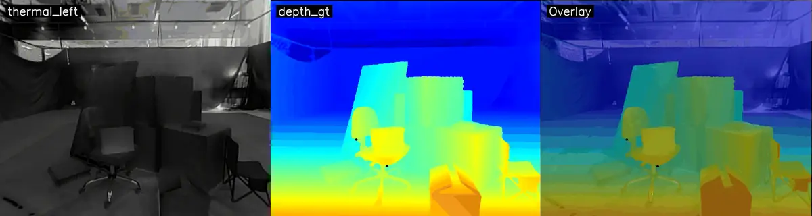

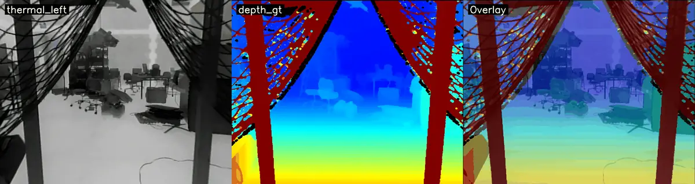~~~~

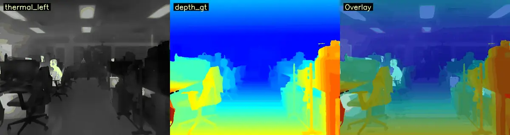

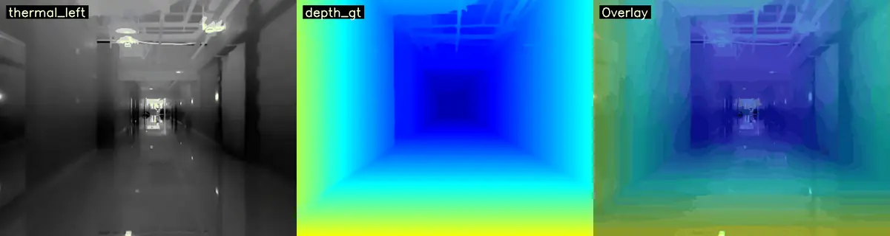

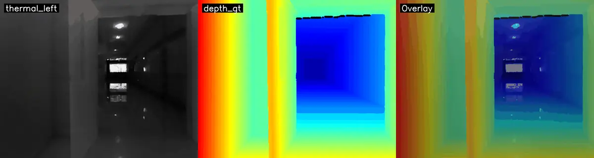

Thermal-Raft-Stereo perfromerce & Comparison results

# **Platform**

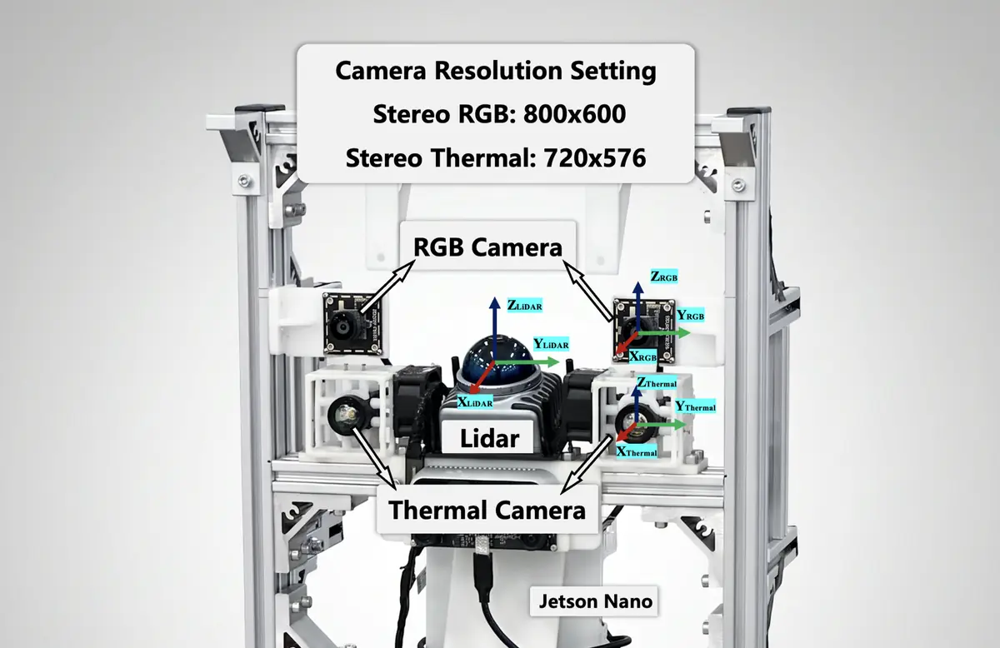

# Thermal Depth Reconstruction

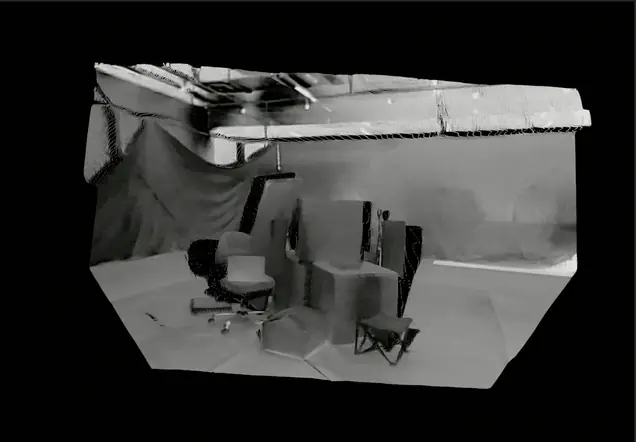 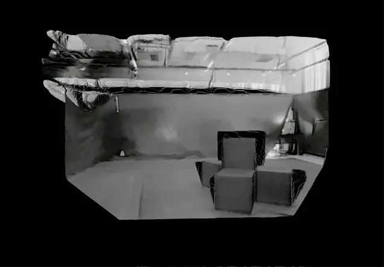

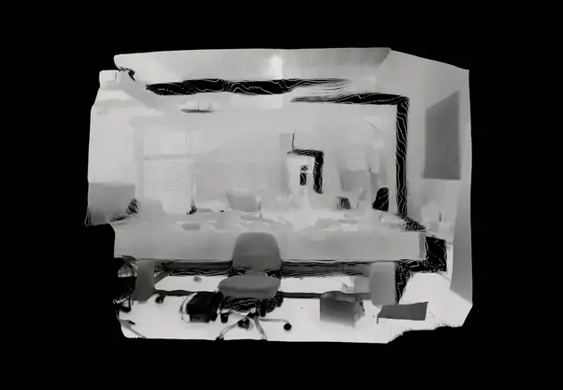 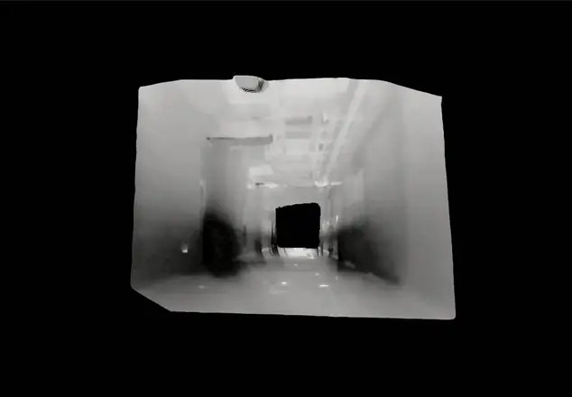

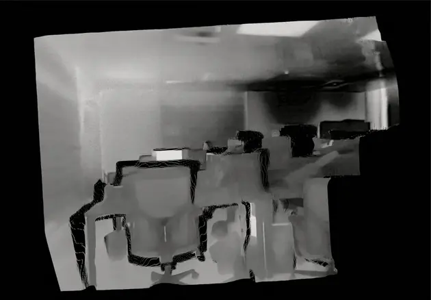 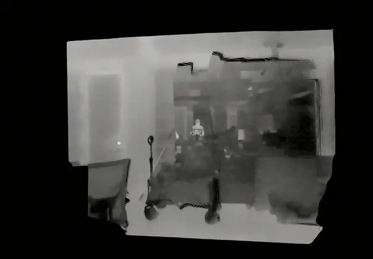

# Disparity Comparison

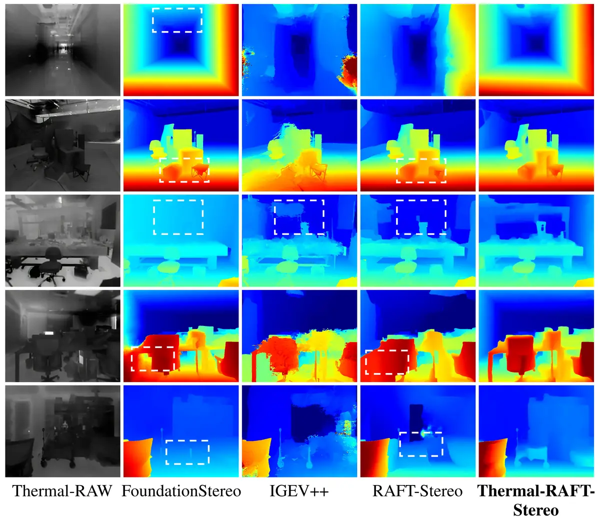
